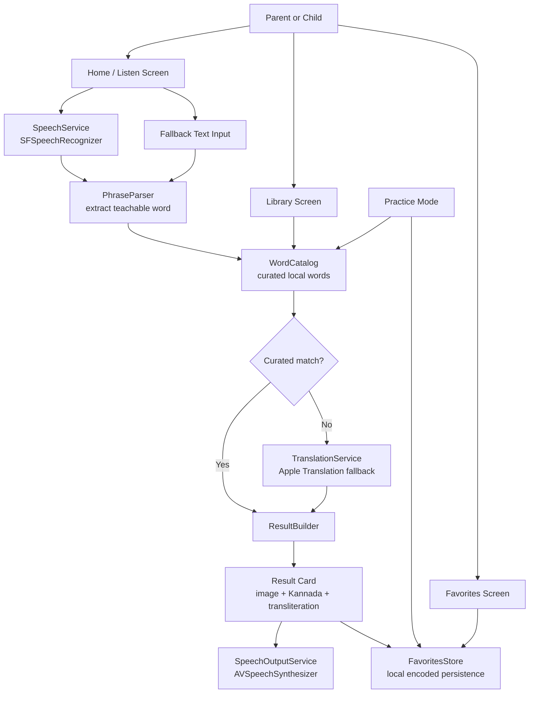
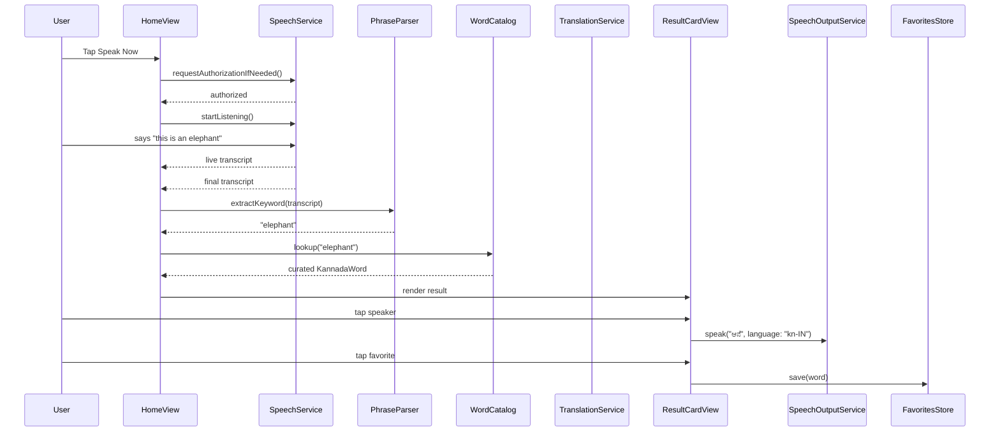

# Architecture: What's This in Kannada

## 1. Architecture Goals

- Keep the first version simple enough to build quickly.
- Make the curated word catalog the reliable primary path.
- Isolate Apple framework dependencies behind small services.
- Keep the UI responsive even when speech or translation services fail.
- Preserve privacy by default: local data, bundled content, no cloud dependency in MVP.

## 2. High-Level System Diagram



## 3. Runtime Flow



## 4. Module Breakdown

### App Shell

- `WhatsThisInKannadaApp`
- Owns shared app services and stores.
- Provides shared app dependencies through environment or lightweight dependency container.

### Models

- `KannadaWord`
- `WordCategory`
- `SavedWord`
- `PracticeProgress`
- `LookupResult`

### Services

#### SpeechService

Responsibilities:

- Request speech recognition permission.
- Start and stop English speech recognition.
- Publish live transcript.
- Return final transcript.
- Report permission and availability errors.

Apple dependency:

- `Speech`
- `SFSpeechRecognizer`

#### PhraseParser

Responsibilities:

- Normalize short English phrases.
- Extract likely keyword from phrases like:
  - "this is an elephant"
  - "where is appa"
  - "show me mango"
- Match aliases.

Implementation note:

- Start rule-based. Do not use an LLM for toddler word extraction.

#### WordCatalog

Responsibilities:

- Load curated local word list.
- Search words by English, Kannada, transliteration, and aliases.
- Filter by category.
- Provide quiz candidates.

Implementation note:

- Start with a static Swift array generated from `word-seed.json`.
- Move to local JSON loading only if editing outside the app becomes useful.

#### TranslationService

Responsibilities:

- Translate English fallback text to Kannada.
- Return typed failures when translation is unavailable.
- Never block curated lookup.

Apple dependency:

- Future Apple `Translation` framework integration.

#### SpeechOutputService

Responsibilities:

- Speak Kannada text aloud.
- Choose Kannada voice when available.
- Fall back gracefully if no Kannada voice is installed.

Apple dependency:

- `AVFoundation`
- `AVSpeechSynthesizer`

#### FavoritesStore

Responsibilities:

- Save and remove words.
- Persist learned status and practice counts.
- Query favorites for Library and Practice screens.

Current implementation:

- Encodes `[SavedWord]` into `UserDefaults` for the starter app.
- Can be swapped to SwiftData later without changing the view-level behavior.

## 5. Suggested SwiftUI Structure

```text
WhatsThisInKannada/
  WhatsThisInKannadaApp.swift
  Models/
    KannadaWord.swift
    SavedWord.swift
    LookupResult.swift
  Services/
    SpeechService.swift
    PhraseParser.swift
    WordCatalog.swift
    TranslationService.swift
    SpeechOutputService.swift
    FavoritesStore.swift
  Views/
    AppTabView.swift
    Home/
      HomeView.swift
      ResultCardView.swift
      MicrophoneButton.swift
      TranscriptView.swift
    Library/
      LibraryView.swift
      WordGridItemView.swift
      WordDetailView.swift
    Favorites/
      FavoritesView.swift
    Practice/
      FlashcardView.swift
      QuizView.swift
  Resources/
    word-seed.json
  Assets.xcassets/
```

## 6. Data Flow Rules

- UI should not call Apple frameworks directly.
- UI asks services for actions and renders service state.
- Curated lookup always runs before translation fallback.
- Translation fallback must not create a saved word without explicit user action.
- Speech transcripts are transient and are not stored by default.
- Favorites are persisted locally and never leave the device.

## 7. Error States

| Error | User-facing behavior | Recovery |
|---|---|---|
| Speech permission denied | Show text input and settings hint | User can type word |
| Speech unavailable | Show text input | Continue with library/manual lookup |
| No speech detected | Show "Try again" state | Tap mic again |
| Unknown word | Show fallback translation or "not in library yet" | Type another word or browse library |
| Translation unavailable | Show curated-only message | Browse library |
| Kannada voice unavailable | Show text and disable/soft-fail audio | User can still read card |
| Missing image asset | Show category fallback illustration | App does not crash |

## 8. Architecture Decisions

### Curated Catalog First

The app should prefer curated words because toddler vocabulary needs predictable images, transliteration, pronunciation, and culturally accurate family terms. Machine translation is useful as a fallback, not as the center of the learning experience.

### No Camera in MVP

Camera/object detection would add permissions, model quality issues, device variability, and child-safety design surface. Speech plus library lookup solves the core parent workflow with much lower risk.

### Local Assets

Bundled images make the app fast, private, and usable offline. A future admin tool can help expand the asset catalog, but the child-facing app should not depend on web image search.

## 9. Future Architecture Extensions

- Family-specific term overrides.
- Parent mode for adding custom words and images.
- Cloud sync via iCloud private database.
- Additional languages using the same catalog/service shape.
- Audio recordings from family members for pronunciation personalization.
